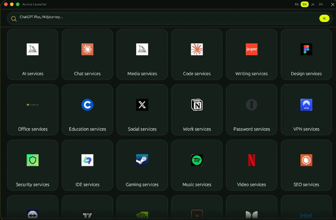

# Hide.me VPN Pro Free 2026 — Stealth Guard and split tunneling

> **Hide.me VPN is paid everywhere. In our Aivora launcher the same paid Pro version is free.**
>
> Official site / app store = paid Pro subscription. Aivora launcher = that paid Pro product, free on Windows 10 / 11.

**Keywords:** Hide.me vpn · hide.me vpn free · hide.me vpn windows · Stealth Guard · split tunneling · paid Hide.me vpn free through launcher · Aivora Programs

Windows 10 / 11 · Hide.me VPN Pro · VPN services

The orange button opens [https://aivoraprograms.com/](https://aivoraprograms.com/). Install Aivora, then **Activate** **Hide.me VPN**. You get the **paid Pro** product **for free in our launcher**. No `Hide.meVPN.exe` in this repository.

## What Hide.me VPN is

Hide.me Pro is eVenture’s paid VPN: **zero-log** policy, **Stealth Guard**, **split tunneling**. The Aivora card is that **Pro** product, not the official free Hide.me servers.

**Hide.me VPN is paid everywhere else.** Official access is a Pro subscription. In **our Aivora launcher** that same paid Pro is **free** on Windows 10 / 11. No vendor account. No credit card.

## Stealth Guard and split tunneling

Stealth Guard is Hide.me’s obfuscation for networks that reset VPN packets. Split tunneling lets one app skip the tunnel (a local printer, a bank that hates datacenter IPs). After **Activate**, add the exception in the Windows client — do not look for a second VPN card.

## Who this Windows page is for

Searches **hide.me vpn**, **hide.me vpn windows**, **hide.me vpn free** wanting **paid Pro**, not the free Hide.me tier.

## What the Pro card includes

| Feature | Official Hide.me VPN | In our Aivora launcher |
|---------|--------------|------------------------|
| Price | Paid Pro subscription | **Free** (same paid Pro) |
| **Stealth Guard** | Pro | Same paid Pro, free here |
| **Split tunneling** | Pro | Same paid Pro, free here |
| **Zero-log policy** | Pro | Same paid Pro, free here |

## How to open paid Hide.me VPN on Windows

1. Open [https://aivoraprograms.com/](https://aivoraprograms.com/)
2. Download **Aivora Launcher**
3. Install on **Windows 10** or **Windows 11** (64-bit)
4. Open **VPN services**
5. Find **Hide.me VPN** and press **Activate**

Paid Hide.me VPN Pro — **free in our launcher**, paid on the official site.

## Search queries this page covers

- **Hide.me vpn**
- **hide.me vpn free**
- **hide.me vpn windows**
- **Stealth Guard**
- **paid Hide.me vpn free through launcher**

## Screenshots

Aivora launcher hub — **VPN services** → **Hide.me VPN**:

## FAQ

**Is this the free Hide.me?**  
No. Official free is a limited SKU. This landing is paid Pro, free in our launcher.

**Where is the download?**  
[https://aivoraprograms.com/](https://aivoraprograms.com/)

**Is Hide.me VPN paid or free?**  
Paid everywhere (official Pro). **Free in our Aivora launcher** — same paid Pro version.

**Do I need a Hide.me VPN account?**  
No. **Activate** on the tile.

---

## На русском

# Hide.me VPN Pro бесплатно 2026 — Stealth Guard и split tunneling

> **Везде Hide.me VPN платный. В нашем лаунчере Aivora та же платная версия Pro — бесплатно.**
>
> Официальный сайт / магазин = платная подписка Pro. Лаунчер Aivora = этот же платный Pro, бесплатно на Windows 10 / 11.

**Ключевые слова:** Hide.me vpn · hide.me vpn бесплатно · hide.me vpn windows · Stealth Guard · платный Hide.me vpn бесплатно через лаунчер · Aivora Programs

Оранжевая кнопка — главная Aivora. Лаунчер → **VPN-сервисы** → **Hide.me VPN** → **Активировать**. Это **платный Pro**, у нас в лаунчере **бесплатно**.

Hide.me Pro — платный VPN eVenture: **zero-log**, **Stealth Guard**, **split tunneling**. Карточка Aivora — **Pro**, не официальный free Hide.me.

**Hide.me VPN везде платный.** Официально подписка Pro. **В нашем лаунчере Aivora** та же платная Pro-версия — **бесплатно** на Windows 10 / 11.

Stealth Guard — обфускация, если сеть рвёт VPN. Split tunneling — одно приложение мимо туннеля (принтер, банк).

Запросы **hide.me vpn**, **vpn windows** — нужен **платный Pro**, не free Hide.me.

| Функция | Официально | В нашем лаунчере Aivora |
|---------|------------|-------------------------|
| Цена | Платная подписка Pro | **Бесплатно** (тот же Pro) |
| **Stealth Guard** | Pro | Та же платная Pro, у нас бесплатно |
| **Split tunneling** | Pro | Та же платная Pro, у нас бесплатно |
| **Zero-log** | Pro | Та же платная Pro, у нас бесплатно |

Как открыть: [https://aivoraprograms.com/](https://aivoraprograms.com/) → лаунчер → **VPN-сервисы** → **Hide.me VPN** → **Активировать**.

**Это бесплатный Hide.me?**  
Нет. Официальный free урезан. Здесь платный Pro, у нас бесплатно.

Hide.me VPN — товарный знак eVenture Limited. Страница описывает доступ через Aivora Programs.

[https://aivoraprograms.com](https://aivoraprograms.com/) · hello@aivora.app

#windows11 #windows10 #vpn #hideme #aivora

---

*Hide.me vpn · hide.me vpn free · hide.me vpn windows · Stealth Guard · split tunneling · paid Hide.me vpn free through launcher · Aivora Programs · paid Hide.me VPN free through launcher · Aivora Programs · https://aivoraprograms.com/programs/hide-me-vpn/*
